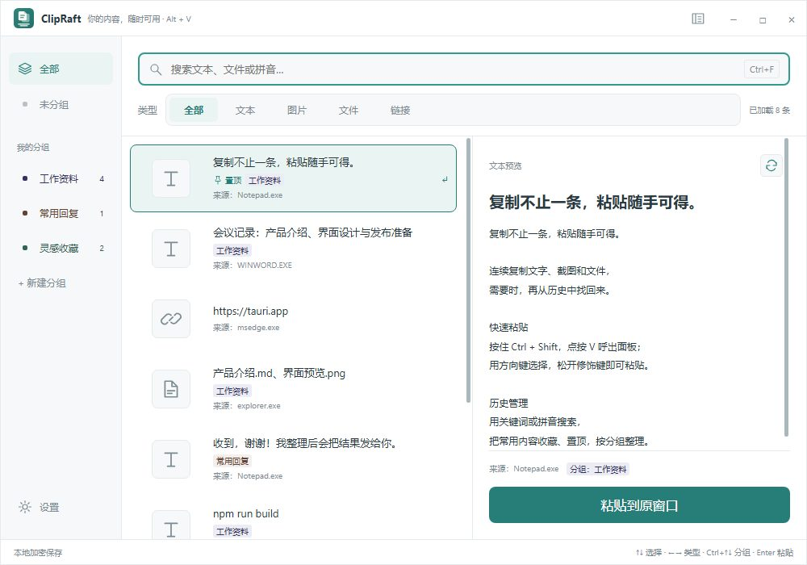

  
  <h1>ClipRaft</h1>
  
<strong>你的内容，随时可用。</strong>

  
Windows 剪贴板管理器 · 快速粘贴 · 多格式历史 · 本地加密

  

    <a href="#核心功能">核心功能</a> ·
    <a href="#快速上手">快速上手</a> ·
    <a href="#常用快捷键">常用快捷键</a> ·
    <a href="#后续计划">后续计划</a>
  

连续复制几段文字、一张截图、几个文件，之前的内容也能随时找回来。ClipRaft 将它们保存在本机，需要时**按住快捷键、选择记录、松手粘贴**，也可以打开主窗口搜索、预览和整理历史。

<picture>
  <source media="(prefers-color-scheme: dark)" srcset="docs/images/main-dark.jpg">
  
</picture>

主窗口预览，使用示例数据。支持浅色和深色外观。

## 核心功能

### ⚡ 按住选择，松手粘贴

在正在编辑的窗口里，按住 **Ctrl + Shift**，点按 **V** 呼出快速面板；用 **↑ / ↓** 或再次点按 **V** 选择历史，松开修饰键即可粘贴。快速面板不获取输入焦点，选择内容时保留原窗口的光标和选区。

有多条历史时，面板默认选中上一条，方便找回刚被新复制内容覆盖的记录。按 **Esc** 可取消本次操作。

### 📋 文字、图片和文件，都能留在历史里

| 内容类型 | 可以怎样使用 |
| --- | --- |
| **文本与富文本** | 保存纯文本、HTML 和 RTF，在支持的应用里保留排版；也可以只粘贴纯文本。 |
| **图片** | 在列表中查看缩略图，打开大图预览，再将图片粘贴到目标应用。 |
| **文件** | 保存单个或多个文件的路径记录，可粘贴成文件、用默认应用打开，或定位到原位置。 |
| **链接** | 从历史中找回复制的网址，直接用默认浏览器打开。 |

文件记录依赖原文件仍在对应路径；富文本、图片和文件的粘贴效果取决于目标应用支持的格式。

### 🔎 找得快，也整理得好

- **关键词与拼音搜索**：用文本、文件名、全拼或拼音首字母查找历史。
- **类型与分组筛选**：按文本、图片、文件、链接缩小范围，也可以结合分组查找。
- **置顶、收藏与分组**：让常用回复、工作资料和临时片段各有位置。
- **自动清理**：按条数、空间和保留天数管理历史，减少手动整理。

### 🎨 按自己的习惯查看内容

提供**列表、双列和紧凑模式**，支持浅色、深色外观。浏览历史时在预览区确认内容；紧凑模式可配合独立浮动预览，在较小窗口里查看记录。

主窗口和快速面板的快捷键均可自定义，遇到组合冲突时可在设置中检测并更换。

### 🔒 历史留在本机，隐私由你掌握

- **加密保存**：历史数据库使用 SQLCipher 加密，本机密钥由 Windows DPAPI 保护。
- **忽略指定程序**：为不希望记录的应用设置排除规则。
- **敏感内容保护**：对命中规则的内容打码预览，并按设置到期清理。
- **随时暂停**：通过系统托盘暂停或恢复剪贴板监听。

本地加密保护落盘数据；敏感识别按规则工作，不能保证识别所有私密内容。

### 📦 备份、恢复与更换存储位置

在设置中用密码导出加密备份，需要时恢复历史；也可以将数据迁移到自选目录。更换电脑或 Windows 账户时，请使用密码导出包迁移数据。

## 快速上手

> 当前开发版本：**0.6.2**。处于早期测试与发布准备阶段，尚未提供公开下载。

**运行环境：** Windows x64，需要 [Microsoft Edge WebView2 Runtime](https://developer.microsoft.com/microsoft-edge/webview2/)。当前以 Windows 11 为主要验证环境，Windows 10 兼容性仍待进一步验证。

获取测试用 ZIP 包后：

1. **解压并启动**：将压缩包解压到独立文件夹，双击 `ClipRaft.exe`，程序会驻留系统托盘。
2. **试一次快速粘贴**：依次复制两段不同的文字，在输入框按住 **Ctrl + Shift**、点按 **V**，再松开修饰键，即可粘贴第一段文字。
3. **查看完整历史**：按 **Alt + V** 或点击托盘图标打开主窗口，搜索、预览并整理记录。

关闭主窗口后程序继续在托盘运行；完整退出请使用托盘菜单中的“退出”。

使用前了解

- **ZIP 解压运行不等于数据便携**：历史与设置默认保存在用户目录，不会自动跟随程序文件夹移动；更换位置请使用应用内的数据迁移功能。
- **向管理员窗口粘贴受 Windows 权限限制**：普通权限运行的 ClipRaft 无法向管理员权限的目标应用自动粘贴。
- **日常数据密钥绑定 Windows 账户**：直接复制数据目录不能替代跨账户备份，请通过密码导出包迁移。

## 常用快捷键

以下为默认设置。快速面板与主窗口的呼出快捷键可在设置中修改。

| 场景 | 操作 | 效果 |
| --- | --- | --- |
| 任意窗口 | 按住 **Ctrl + Shift**，点按 **V** | 呼出快速面板，默认选择上一条记录 |
| 快速面板 | **↑ / ↓**，或再次点按 **V** | 切换记录；松开修饰键后粘贴 |
| 快速面板 | **Esc** | 取消本次粘贴 |
| 任意窗口 | **Alt + V** | 呼出或隐藏主窗口 |
| 主窗口 | **Ctrl + F** | 返回搜索框 |
| 主窗口 | **↑ / ↓** · **← / →** · **Ctrl + ↑ / ↓** | 选择记录 · 切换类型 · 切换分组 |
| 主窗口 | **Enter** / **Shift + Enter** | 粘贴所选记录 / 仅粘贴其中的纯文本 |

搜索框有文字时，左右键用于移动光标；按上下键进入列表后可切换类型。纯文本粘贴要求记录包含纯文本格式。

## 后续计划

以下功能尚未实现，具体方案和排期可能调整：

- **主题与背景扩展**：Fluent 风格、窗口材质和自定义背景图。
- **加密云备份**：在本机加密后上传历史快照，支持按备份版本恢复。
- **多设备同步**：通过端到端加密同步记录，让已授权设备接续使用。

## 开发与反馈

ClipRaft 基于 **Tauri 2 + Vue 3 + TypeScript + Rust** 开发，通过 Win32 API 处理剪贴板、全局快捷键和粘贴。

构建、测试及实现说明见 [开发与验收记录](docs/开发与验收记录.md)，接续开发请先阅读 [项目交接](docs/handoff.md)。当前构建脚本包含本机工具链路径，从源码运行前需要按本地环境调整。

欢迎反馈使用体验、问题和功能建议。描述问题时，请附上系统与应用版本、复现步骤、预期和实际结果；截图请使用不含隐私的示例内容。

## 开源协议

本项目采用 [MIT 许可证](LICENSE)，允许商用、修改和再分发，使用时需保留版权与许可文本。第三方组件遵循各自的许可证，详见 [第三方组件说明](THIRD-PARTY-NOTICES.md)。
